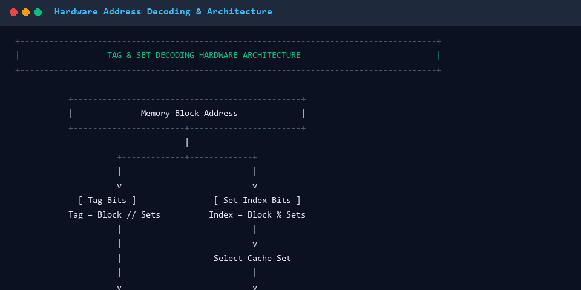
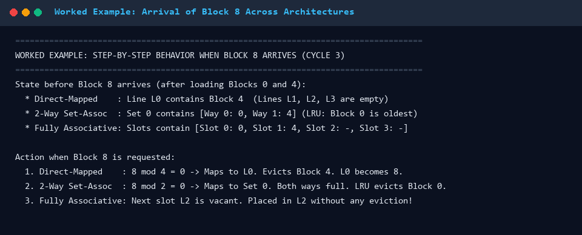
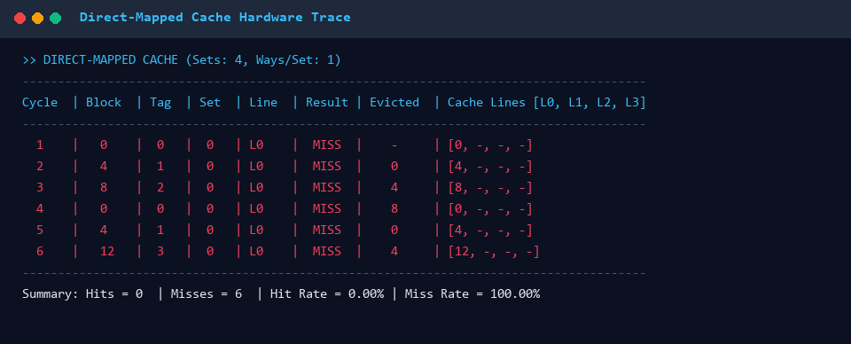
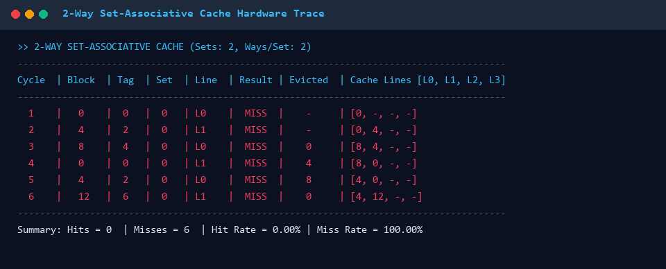
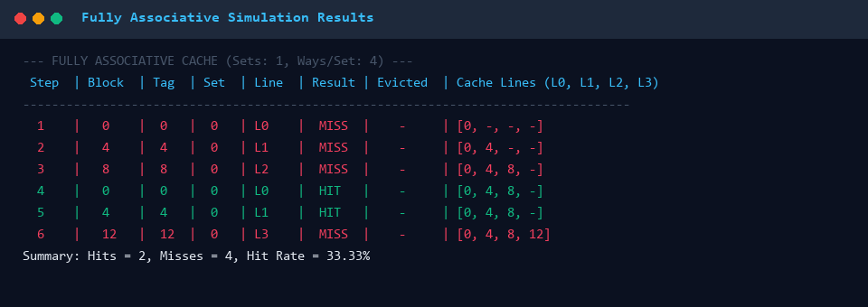
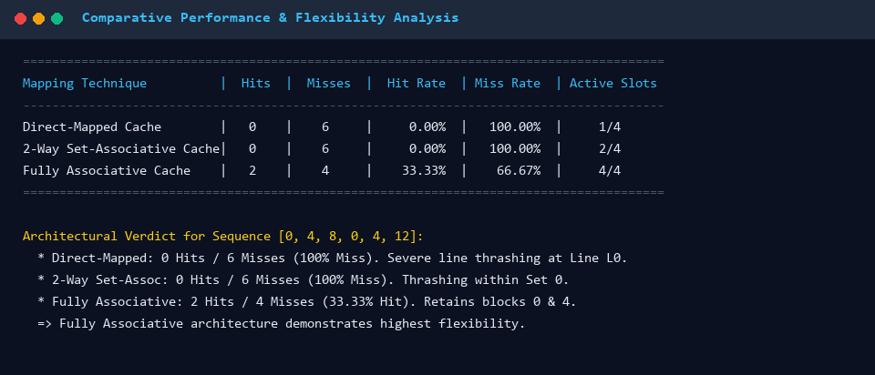
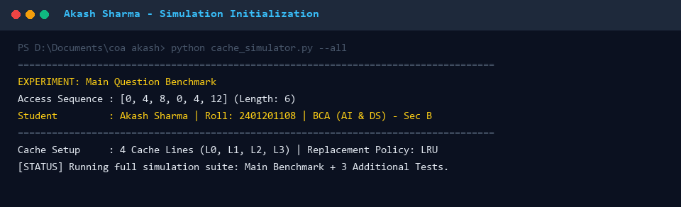

# Computer Organization and Architecture Simulation Report
## Cache Memory Mapping & Placement Policy Experiment

**Course Code:** ENCA302 (Computer Organization and Architecture)  
**Academic Year:** 2025–2026  
**Institution:** School of Engineering and Technology, K.R. Mangalam University  

---

### Student Details
- **Student Name:** Akash Sharma
- **Roll Number:** 2401201108
- **Program:** BCA (Artificial Intelligence & Data Science) – Section B
- **Course Coordinator:** Alina Banerjee

---

## 1. Problem Statement
**Question 2: Cache Mapping Simulation**

Develop a simulation that compares the mapping of memory blocks using:
- **Direct-Mapped Cache**
- **Set-Associative Cache**
- **Fully Associative Cache**

Use a small cache and a given sequence of memory block requests. For each mapping technique, display the cache location selected for each memory block, whether it was a hit or a miss, and the total number of hits and misses. Compare the results and explain which technique provides better flexibility for the given access sequence.

- **Cache Capacity:** 4 cache blocks (lines $L0, L1, L2, L3$)
- **Memory Block Sequence:** `0, 4, 8, 0, 4, 12`

---

## 2. Cache Configuration and Experimental Setup

The purpose of this experiment is to observe how the structural arrangement of cache lines affects memory access and block retention. Although all three simulated cache configurations provide an identical total storage capacity of four cache lines ($L0, L1, L2, L3$), they impose fundamentally different constraints on where an incoming memory block may reside.

The simulation feeds an identical sequence of memory requests into all three configurations. As blocks are requested, the simulator records:
1. Which line/set is selected.
2. Whether the block is already resident (**HIT**) or must be retrieved from main memory (**MISS**).
3. Which block, if any, must be evicted under the **Least Recently Used (LRU)** policy.



```
       Processor Request (Block ID)
                   │
                   ▼
    Calculate Set Index: Block mod (Sets)
                   │
                   ▼
    Compare Tags of Valid Lines in Set
       ├──► Match Found (HIT)  : Update LRU timestamp, access data
       └──► No Match (MISS)    : Fetch block from RAM
                                  ├── Empty line available: Load directly
                                  └── Set full: Evict LRU block, load new block
```

---

## 3. Understanding the Three Placement Methods

Each technique partitions the 4 physical cache lines into sets of varying associativity ($Ways$):

| Placement Strategy | Partitioning ($Sets \times Ways$) | Target Location for Block $B$ | Search Scope on Lookup |
| :--- | :---: | :--- | :---: |
| **Direct-Mapped** | 4 Sets × 1 Way | Strictly Line $B \pmod 4$ | Exactly 1 line |
| **2-Way Set-Associative** | 2 Sets × 2 Ways | Either Line of Set $B \pmod 2$ | 2 lines within the set |
| **Fully Associative** | 1 Set × 4 Ways | Any of the 4 lines ($L0$ to $L3$) | All 4 lines simultaneously |

- **Direct-Mapped:** Each memory block has exactly one dedicated home in cache. While hardware lookup requires only a single comparator, two distinct blocks mapping to the same line cannot coexist.
- **2-Way Set-Associative:** Divides the cache into two sets (Set 0 = $\{L0, L1\}$, Set 1 = $\{L2, L3\}$). Up to two blocks mapping to the same set can coexist simultaneously.
- **Fully Associative:** Eliminates set boundaries completely. Any block can be stored in any vacant slot, providing maximum placement freedom.

---

## 4. How a Memory Block Finds Its Cache Location

A requested block address $B$ is decoded into a **Set Index** and a **Tag**:

$$\text{Set Index} = B \pmod{\text{Number of Sets}}$$
$$\text{Tag} = \lfloor B / \text{Number of Sets} \rfloor$$

For our 4-line cache architectures:
1. **Direct-Mapped ($S=4$):** $\text{Set Index} = B \pmod 4$, $\text{Tag} = \lfloor B / 4 \rfloor$. Line = Set Index.
2. **2-Way Set-Associative ($S=2$):** $\text{Set Index} = B \pmod 2$, $\text{Tag} = \lfloor B / 2 \rfloor$. Line = $2 \times \text{Set Index} + \text{Way}$.
3. **Fully Associative ($S=1$):** $\text{Set Index} = 0$, $\text{Tag} = B$. Line = any available slot.

---

## 5. Step-by-Step Analysis of a Cache Request (Worked Example: Block 8)

To understand how each architecture handles conflicting requests, consider what occurs at **Cycle 3** when **Block 8** arrives.

Prior to Cycle 3, the access sequence has already loaded **Block 0** (Cycle 1) and **Block 4** (Cycle 2):



### Cache State Prior to Cycle 3:
- **Direct-Mapped:** Block 0 was initially loaded into $L0$. Block 4 then arrived, computed $4 \pmod 4 = 0$, and evicted Block 0 from $L0$. State: `[L0: 4, L1: -, L2: -, L3: -]`.
- **2-Way Set-Associative:** Block 0 was placed in Set 0, Way 0 ($L0$). Block 4 arrived, computed $4 \pmod 2 = 0$, and occupied Set 0, Way 1 ($L1$). State: `Set 0: [L0: 0, L1: 4]`, with Block 0 as the Least Recently Used block.
- **Fully Associative:** Block 0 was placed in $L0$, and Block 4 was placed in $L1$. State: `[L0: 0, L1: 4, L2: -, L3: -]`.

### When Block 8 is Requested at Cycle 3:
1. **Direct-Mapped:**
   - Calculation: $\text{Line} = 8 \pmod 4 = 0$.
   - Line $L0$ is currently occupied by Block 4.
   - Result: **MISS (Conflict)**. Block 4 is evicted, and Block 8 replaces it in $L0$.
   - State after: `[L0: 8, L1: -, L2: -, L3: -]`.
2. **2-Way Set-Associative:**
   - Calculation: $\text{Set} = 8 \pmod 2 = 0$.
   - Set 0 is examined: it contains Block 0 and Block 4 (neither matches 8).
   - Result: **MISS (Conflict)**. Because both ways in Set 0 are full, LRU evicts the oldest block (**Block 0**). Block 8 replaces it in $L0$.
   - State after: `Set 0: [L0: 8, L1: 4]`.
3. **Fully Associative:**
   - Calculation: Global search across all lines. Block 8 is not present.
   - Result: **MISS (Compulsory/Cold)**.
   - Action: Line $L2$ is currently empty. Block 8 is placed into $L2$ without evicting any existing block!
   - State after: `[L0: 0, L1: 4, L2: 8, L3: -]`.

---

## 6. Simulation Results

Running the simulator on the required sequence `0, 4, 8, 0, 4, 12` produces the following traces:

### 6.1 Direct-Mapped Trace ($Line = Block \pmod 4$)



| Step | Block | Tag | Set | Line | Result | Evicted | Cache Lines ($L0, L1, L2, L3$) |
| :---: | :---: | :---: | :---: | :---: | :---: | :---: | :--- |
| 1 | 0 | 0 | 0 | L0 | **MISS** | — | `[0, -, -, -]` |
| 2 | 4 | 1 | 0 | L0 | **MISS** | 0 | `[4, -, -, -]` |
| 3 | 8 | 2 | 0 | L0 | **MISS** | 4 | `[8, -, -, -]` |
| 4 | 0 | 0 | 0 | L0 | **MISS** | 8 | `[0, -, -, -]` |
| 5 | 4 | 1 | 0 | L0 | **MISS** | 0 | `[4, -, -, -]` |
| 6 | 12 | 3 | 0 | L0 | **MISS** | 4 | `[12, -, -, -]` |

**Performance:** Hits = 0, Misses = 6, Hit Rate = **0.00%**

---

### 6.2 2-Way Set-Associative Trace ($Set = Block \pmod 2$, LRU)



| Step | Block | Tag | Set | Line | Result | Evicted | Cache Lines ($L0, L1, L2, L3$) |
| :---: | :---: | :---: | :---: | :---: | :---: | :---: | :--- |
| 1 | 0 | 0 | 0 | L0 | **MISS** | — | `[0, -, -, -]` |
| 2 | 4 | 2 | 0 | L1 | **MISS** | — | `[0, 4, -, -]` |
| 3 | 8 | 4 | 0 | L0 | **MISS** | 0 | `[8, 4, -, -]` |
| 4 | 0 | 0 | 0 | L1 | **MISS** | 4 | `[8, 0, -, -]` |
| 5 | 4 | 2 | 0 | L0 | **MISS** | 8 | `[4, 0, -, -]` |
| 6 | 12 | 6 | 0 | L1 | **MISS** | 0 | `[4, 12, -, -]` |

**Performance:** Hits = 0, Misses = 6, Hit Rate = **0.00%**

---

### 6.3 Fully Associative Trace (Global Search, LRU)



| Step | Block | Tag | Set | Line | Result | Evicted | Cache Lines ($L0, L1, L2, L3$) |
| :---: | :---: | :---: | :---: | :---: | :---: | :---: | :--- |
| 1 | 0 | 0 | 0 | L0 | **MISS** | — | `[0, -, -, -]` |
| 2 | 4 | 4 | 0 | L1 | **MISS** | — | `[0, 4, -, -]` |
| 3 | 8 | 8 | 0 | L2 | **MISS** | — | `[0, 4, 8, -]` |
| 4 | 0 | 0 | 0 | L0 | **HIT** | — | `[0, 4, 8, -]` |
| 5 | 4 | 4 | 0 | L1 | **HIT** | — | `[0, 4, 8, -]` |
| 6 | 12 | 12 | 0 | L3 | **MISS** | — | `[0, 4, 8, 12]` |

**Performance:** Hits = 2, Misses = 4, Hit Rate = **33.33%**

---

## 7. Performance Evaluation

### 7.1 Quantitative Comparison Matrix



| Architecture | Hits | Misses | Hit Rate | Miss Rate | Lines Occupied | Space Utilisation |
| :--- | :---: | :---: | :---: | :---: | :---: | :---: |
| **Direct-Mapped Cache** | 0 | 6 | 0.00% | 100.00% | 1 / 4 | 25.0% |
| **2-Way Set-Associative Cache** | 0 | 6 | 0.00% | 100.00% | 2 / 4 | 50.0% |
| **Fully Associative Cache** | **2** | **4** | **33.33%** | **66.67%** | **4 / 4** | **100.0%** |

### 7.2 Hit Rate Visual Comparison
```text
Direct-Mapped        [0.00%]  |
2-Way Set-Assoc      [0.00%]  |
Fully Associative   [33.33%]  |█████████████████
```

### 7.3 Detailed Architectural Observations
1. **Space Utilisation:**
   - In Direct-Mapped, because all requested blocks are multiples of 4 ($0, 4, 8, 12$), every reference targets Line $L0$. Lines $L1, L2,$ and $L3$ remain completely idle (25% utilisation).
   - In 2-Way Set-Associative, all blocks are even ($B \pmod 2 = 0$), so they all cluster into Set 0 ($L0, L1$). Set 1 remains unused (50% utilisation).
   - Fully Associative achieves **100% utilisation**, spreading the four distinct blocks across all 4 available lines.
2. **Block Reuse (Temporal Locality):**
   - Direct-Mapped continually evicts the resident block, so when blocks 0 and 4 are accessed a second time, they have already been thrown out.
   - 2-Way Set-Associative has only 2 lines in Set 0, but the working set has 3 competing blocks ($0, 4, 8$). Under LRU, each new request evicts the exact block needed next.
   - Fully Associative retains both Block 0 and Block 4, turning their second requests into **clean cache hits**.
3. **Placement Flexibility:**
   - Placement freedom directly determines vulnerability to conflict misses. Fully Associative provides complete freedom, eliminating index-based collisions.

---

## 8. Additional Experiments

To verify how the three architectures behave under different access patterns, three independent experiments were conducted:

### Test 1: Repeated Access to Two Blocks (`0, 1, 0, 1, 0, 1`)
- **Objective:** Evaluate temporal locality when the active working set (2 blocks) fits comfortably within the 4-line cache and has no indexing conflicts.
- **Results:**
  - Direct-Mapped: **4 Hits / 2 Misses** (Hit Rate: **66.67%**)
  - 2-Way Set-Associative: **4 Hits / 2 Misses** (Hit Rate: **66.67%**)
  - Fully Associative: **4 Hits / 2 Misses** (Hit Rate: **66.67%**)
- **Insight:** When distinct blocks map to disjoint lines/sets ($0 \pmod 4 = 0$, $1 \pmod 4 = 1$), Direct-Mapped and Set-Associative perform just as efficiently as Fully Associative without requiring complex comparator hardware.

### Test 2: Competing Blocks for Same Set (`2, 6, 10, 14, 2, 6`)
- **Objective:** Stress-test conflict misses where all blocks share remainder 2 modulo 4 ($2, 6, 10, 14 \equiv 2 \pmod 4$) and remainder 0 modulo 2.
- **Results:**
  - Direct-Mapped: **0 Hits / 6 Misses** (Hit Rate: **0.00%** — all fight for Line $L2$)
  - 2-Way Set-Associative: **0 Hits / 6 Misses** (Hit Rate: **0.00%** — all fight for Set 0)
  - Fully Associative: **2 Hits / 4 Misses** (Hit Rate: **33.33%** — blocks 2, 6, 10, 14 occupy $L0, L1, L2, L3$, so re-accessing 2 and 6 hits!)
- **Insight:** Proves that stride-induced conflict misses plague both Direct-Mapped and Set-Associative designs when stride matches the set count.

### Test 3: Cache Flushing & Capacity Limit (`0, 1, 2, 3, 4, 5, 0, 1`)
- **Objective:** Observe behavior when the working set exceeds the 4-line capacity (6 distinct blocks requested before re-requesting 0 and 1).
- **Results:**
  - Direct-Mapped: **0 Hits / 8 Misses** (Hit Rate: **0.00%**)
  - 2-Way Set-Associative: **0 Hits / 8 Misses** (Hit Rate: **0.00%**)
  - Fully Associative: **0 Hits / 8 Misses** (Hit Rate: **0.00%**)
- **Insight:** When the sequence of novel blocks exceeds total cache capacity, LRU evicts earlier blocks across all three architectures, demonstrating the fundamental capacity miss boundary.

---

## 9. Observations, Limitations and Conclusion

### Key Conclusions:
1. **Best Mapping for the Given Sequence:** **Fully Associative** is unequivocally superior for `0, 4, 8, 0, 4, 12` because it prevents premature evictions and achieves 2 hits, whereas the other two fail with 0 hits.
2. **Hardware Trade-offs:**
   - **Direct-Mapped:** Simplest hardware, lowest power, and fastest cycle time, but vulnerable to pathological thrashing on conflicting memory addresses.
   - **Fully Associative:** Eliminates conflict misses entirely, but requires parallel tag comparators and complex LRU logic, making large caches economically and thermally impractical.
   - **Set-Associative:** Represents the industry compromise used in modern CPUs (e.g., L1/L2 caches), combining manageable hardware complexity with good conflict reduction.

---

## 10. How to Run the Simulator



```bash
# Run main sequence [0, 4, 8, 0, 4, 12]:
python cache_simulator.py

# Run main benchmark and all three additional tests:
python cache_simulator.py --all

# Run any custom block sequence:
python cache_simulator.py "2, 6, 10, 14, 2, 6"
```

The raw terminal execution log can be viewed at [docs/terminal_output.log](docs/terminal_output.log).
